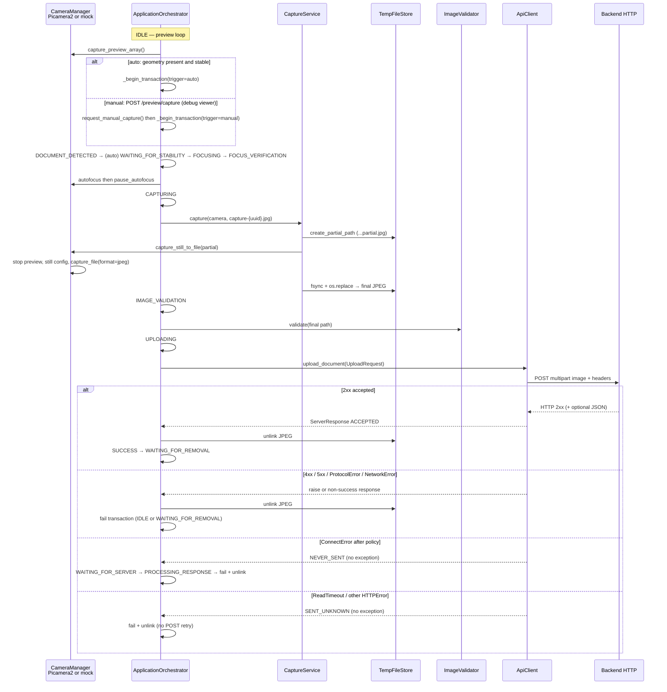

# Backend Image Pipeline Audit

**Scope:** Current source in this repository (read-only).  
**Rule:** Behavior is taken from executable code, configuration schemas, and tests. Documentation is cited only when it disagrees with code.  
**Audit date:** 2026-08-28  
**Application:** idCam (`src/idcam`) — Raspberry Pi document capture client.

Legend used below:

- **FACT** — observed in code / config / tests.
- **INFERENCE** — reasonable conclusion from facts, not independently encoded.
- **NOT IMPLEMENTED** — searched; no corresponding code.
- **UNKNOWN — NOT DEFINED IN CURRENT CODE** — cannot be determined from this repo.

---

## 1. Executive Summary

This client captures **one JPEG still at a time**, writes it to a temp file, validates it locally, then **POSTs the file as `multipart/form-data` field `image`** to `{server.url}{server.path}` (default path `/api/document`). Identification is carried in HTTP headers (`X-Device-ID`, `X-Capture-ID`, `Idempotency-Key`). The image bytes are **not** wrapped in JSON and **not** base64-encoded.

There is **no upload queue**, **no persistent spool**, and **no retry after the request body is sent**. Failed or ambiguous uploads **delete the local JPEG** and require a **new capture** (new `capture_id`). Concurrent capture-while-upload is **blocked** by a single transaction and the state machine.

The **request shape is implementable**. The **response contract is not a single strict schema**: empty 2xx bodies can succeed; JSON objects that parse are required to contain `success`; malformed JSON on 2xx is treated as success. Several fields the client computes (`created_at`, SHA-256, dimensions) are **never sent**.

**Verdict:** see **Final Verdict** at the end of this document.

---

## 2. End-to-End Data Flow

### 2.1 Sequence (actual code)



### 2.2 Transition table (file / function)

| Step | Module | Function / class | Location |
|------|--------|------------------|----------|
| App start, HTTP client created | `src/idcam/app/orchestrator.py` | `ApplicationOrchestrator._startup` | lines 161–217 (`await self.api.start()` at 174) |
| Capture trigger (auto) | `orchestrator.py` | `_idle_tick` | 411–458 |
| Capture trigger (manual) | `orchestrator.py` | `request_manual_capture`, `_take_manual_request` | 491–544 |
| Manual HTTP surface (not backend) | `src/idcam/preview/live_viewer.py` | `Handler._serve_capture` | 514–553 |
| Transaction ID | `src/idcam/app/transaction.py` | `ActiveCaptureTransaction.generate_id` | 58–61 |
| AF before still | `orchestrator.py` | `_focusing_tick`, `_focus_verification_tick` | 612–678 |
| Still capture | `src/idcam/camera/capture.py` | `CaptureService.capture` | 28–55 |
| Encoder | `src/idcam/camera/manager.py` | `CameraManager.capture_still_to_file` | 261–313 |
| Temp file | `src/idcam/storage/temp_files.py` | `create_temp_path`, `finalize_capture` | 35–65 |
| Validate | `src/idcam/camera/quality.py` | `ImageValidator.validate` | 38–121 |
| Build upload | `orchestrator.py` | `_uploading_tick` | 731–765 |
| HTTP | `src/idcam/network/api_client.py` | `ApiClient.upload_document` | 56–185 |
| Parse response | `src/idcam/network/protocol.py` | `ServerResponse.from_http`, `validate_json_body` | 38–99 |
| Success / fail | `orchestrator.py` | `_processing_response_tick`, `_fail_transaction_and_wait` | 772–991 |
| Delete file | `orchestrator.py` | `_cleanup_transaction_files` | 993–996 |
| Re-arm | `orchestrator.py` | `_success_tick`, `_removal_tick` | 811–855 |

---

## 3. Capture Pipeline

### 3.1 How capture is triggered

**FACT — two production paths, one diagnostic path:**

1. **Automatic (unattended)**  
   In `IDLE`, if disk `can_capture`, a preview frame is taken. Geometry detection must report a document **present** and **geometry-stable**. Then `_begin_transaction(trigger="auto")` and transition to `DOCUMENT_DETECTED`.  
   `src/idcam/app/orchestrator.py` `_idle_tick` lines 411–458.

2. **Manual**  
   `request_manual_capture()` is allowed only in `IDLE` or `WAITING_FOR_REMOVAL`, with no active transaction and a healthy camera. It sets `_pending_command = "manual_capture"` and **blocks the calling thread** until the pipeline finishes or `timeout` (default 180 s).  
   The optional Live Debug Viewer `POST /preview/capture` calls this handler. That POST is **local debug HTTP**, not the backend upload.  
   `orchestrator.py` 491–536; `live_viewer.py` 498–553.

   From `IDLE` or `WAITING_FOR_REMOVAL`, `_take_manual_request()` starts a transaction with `trigger="manual"`. Manual skips stability: `DOCUMENT_DETECTED` → `FOCUSING` immediately (`_document_detected_tick` 575–582).

3. **Diagnostic scripts** (`scripts/camera_capture_test.py`, `scripts/document_detect_test.py`) capture to disk for hardware checks. They **do not** call `ApiClient.upload_document`.

**FACT — no other backend-related capture trigger** was found (no admin CLI capture, no second HTTP client).

### 3.2 Component responsible for capture

| Role | Class | File |
|------|--------|------|
| Pipeline owner | `ApplicationOrchestrator` | `src/idcam/app/orchestrator.py` |
| Still I/O + timeout | `CaptureService` | `src/idcam/camera/capture.py` |
| Sensor / encoder | `CameraManager.capture_still_to_file` | `src/idcam/camera/manager.py` |
| File atomicity | `TempFileStore` | `src/idcam/storage/temp_files.py` |

Exact capture function: **`CaptureService.capture`** (`capture.py` 28–55), invoked from **`ApplicationOrchestrator._capturing_tick`** (`orchestrator.py` 680–701).

### 3.3 Autofocus before capture

**FACT:** State order is `FOCUSING` → `FOCUS_VERIFICATION` → `CAPTURING`. Capture tick does not start until focus verification succeeds or retries exhaust (`_focus_verification_tick` 657–678).

**FACT:** After AF, `pause_autofocus` is invoked if present (`_focusing_tick` 641–643). Still capture holds lens position when metadata provides `LensPosition` (`manager.py` 277–292).

**FACT:** Hardware AF success is **preview-ROI Laplacian improvement**, not “AfState == Focused required.” `CameraManager.autofocus_cycle` waits for lens settle, not AfState (`manager.py` 516–520). If AF hardware is missing, capabilities are `degraded` (`autofocus.py` 56–59); the pipeline still attempts `run_autofocus` and can fail with `AutofocusError`.

**INFERENCE:** Capture is intended after AF/verify, but “autofocus completed” is **software-accepted preview sharpness**, not a guaranteed hardware `AfState=Focused` for every camera.

### 3.4 Image format and resolution

**FACT — still configuration request:** RGB888 at `camera.capture_width` × `camera.capture_height`. Defaults **9152 × 6944** (`schema.py` `CameraConfig` 63–64; `manager.py` 175–181).

**FACT — file format:** `STILL_ENCODER_FORMAT = "jpeg"` passed to `Picamera2.capture_file(..., format=STILL_ENCODER_FORMAT)` (`manager.py` 38–40, 300). Mock path saves JPEG via PIL (`manager.py` 680–694).

**FACT — configured vs actual:** `stream_geometry()` notes libcamera may align sizes (`manager.py` 356–407). Validation may require dimensions near config if `quality.require_expected_dimensions` is true (`quality.py` 76–82). Example YAML sets `require_expected_dimensions: false` (`config.example.yaml` 75). **Schema default is `true`** (`schema.py` 111). Runtime value is whatever is in the loaded YAML.

**FACT — JPEG quality:** `camera.jpeg_quality` default **95** (`schema.py` 65). Used in **mock** `img.save(..., quality=self.config.jpeg_quality)` (`manager.py` 694). **Not passed** to `capture_file` on the Picamera2 path. Hardware JPEG quality is **UNKNOWN — NOT DEFINED IN CURRENT CODE**.

**FACT — preview vs upload:** Preview is a separate stream (default 1920×1080). Debug MJPEG uses `debug.jpeg_quality` (default 70). **Neither is the upload image.**

### 3.5 Capture IDs and timestamps

**FACT:** `capture_id = "cap-" + uuid.uuid4().hex` (`transaction.py` 58–61). Unique per transaction.

**FACT:** `started_at` and other timestamps exist on `ActiveCaptureTransaction` (local only).

**FACT:** `UploadRequest.created_at` is set in `_uploading_tick` as UTC `YYYY-MM-DDTHH:MM:SSZ` via `time.strftime(..., time.gmtime())` (`orchestrator.py` 749). **It is not placed in headers or multipart fields** (`api_client.py` 70–91).

---

## 4. Image Processing Before Upload

**FACT — what is uploaded:** the **same finalized JPEG file** produced by the still encoder, after validation. Path: `TempFileStore.create_temp_path()` → `capture-{uuid.hex}.jpg` under `config.temp_dir` (default `/var/lib/idcam/tmp`).

**FACT — modifications of the still:**

| Operation | Status |
|-----------|--------|
| Copy after capture | Atomic `os.replace` partial → final only (`temp_files.py` 57–65) |
| Convert / transcode | NOT IMPLEMENTED on hardware path (encoder writes JPEG) |
| Resize | NOT IMPLEMENTED for upload |
| Crop / perspective warp | NOT IMPLEMENTED for upload (geometry is preview-only) |
| Recompress | NOT IMPLEMENTED on hardware path |
| EXIF strip | NOT IMPLEMENTED |
| Watermark | NOT IMPLEMENTED |

**FACT — validation reads the file** (PIL + OpenCV) but **does not rewrite it** (`quality.py` 38–121). SHA-256 is computed for the transaction object and logs, **not sent**.

**FACT — original capture:** only one JPEG (partial then renamed). Partial is removed on capture failure. After success or failure of upload, the file is unlinked. There is **no archive copy**.

**FACT — size gates before HTTP:**  
- `quality.min_file_bytes` / `max_file_bytes` (defaults 100_000 / 50_000_000)  
- `server.max_upload_bytes` (default 50_000_000) in `ApiClient.upload_document` (66–67)

**Typical encoded size:** UNKNOWN — NOT DEFINED IN CURRENT CODE (depends on scene and encoder). Upper bound enforced: 50 MB unless config changed.

---

## 5. Backend Request

There is **one** backend image request: `ApiClient.upload_document`.

### 5.1 Source

- File: `src/idcam/network/api_client.py`  
- Class: `ApiClient`  
- Function: `upload_document`  
- Lines: **56–185**  
- Called from: `ApplicationOrchestrator._uploading_tick` lines **745–752**

### 5.2 URL construction

```text
url = str(self.config.server.url).rstrip("/") + self.config.server.path
```

`api_client.py` line 69.

| Piece | Runtime source |
|-------|----------------|
| Base | `AppConfig.server.url` (`HttpUrl`). YAML `server.url`, or env **`IDCAM_SERVER_URL`** overlay (`loader.py` 68–71). Production (`IDCAM_ENV=production`/`prod`) rejects `example.com` / `*.example.com` (`loader.py` 74–87). Host `unconfigured.invalid` is rejected by schema (`schema.py` 35–42). |
| Path | `server.path`, default **`/api/document`**. Validator prepends `/` if missing (`schema.py` 18–31). |
| Example (dev YAML) | `https://api.example.com` + `/api/document` → `https://api.example.com/api/document` (matches tests `test_api_client.py` 45). |

**FACT:** `check_connectivity` does `HEAD` on the **base URL only**, not `server.path` (`api_client.py` 45–54). Upload does not use that HEAD.

### 5.3 HTTP method

**FACT:** `POST` — `self._client.post(url, headers=headers, files=files)` (`api_client.py` 91).

### 5.4 Authentication

**FACT:** `AuthConfig.resolved_token()` (`schema.py` 49–52):

- If `auth.type == "none"` **or** `auth.token` is empty → **no `Authorization` header**.
- Else `Authorization: Bearer {token}`.

Token runtime sources (`loader.py` 57–62):

1. Env **`IDCAM_AUTH_TOKEN`** (forces `auth.type = bearer` and sets token).  
2. Else YAML `auth.token`.

Example/template files use `auth.type: bearer` with empty token → **no Authorization until env or YAML is filled**.

### 5.5 Headers set by this client

Explicit headers (`api_client.py` 70–77):

| Header | Value |
|--------|--------|
| `X-Device-ID` | `UploadRequest.device_id` = `config.device_id` (YAML or **`IDCAM_DEVICE_ID`**) |
| `X-Capture-ID` | `capture_id` (`cap-` + 32 hex chars) |
| `Idempotency-Key` | **same string as** `X-Capture-ID` |
| `Authorization` | `Bearer …` only if token resolved |

**FACT:** Client does **not** set `Accept`.  
**FACT:** Client does **not** set `Content-Type` manually. httpx sets `multipart/form-data; boundary=...` because `files=` is used.

**INFERENCE:** httpx will also send its default `User-Agent` and `Content-Length` / chunking as the library decides. Those are not customized in this repo.

**FACT:** `follow_redirects=False` (`api_client.py` 37). 3xx is not followed.

### 5.6 TLS

**FACT:** `verify=self.config.server.verify_tls` (default **True**) (`schema.py` 23; `api_client.py` 36).  
**FACT:** URL type is `HttpUrl` (HTTPS expected by Pydantic URL type in practice; scheme comes from config).

### 5.7 Timeouts (HTTP client)

`httpx.Timeout` (`api_client.py` 28–33):

| Parameter | Config key | Default |
|-----------|------------|---------|
| connect | `server.connect_timeout_sec` | 10 s |
| read | `server.read_timeout_sec` | 60 s |
| write | **same as read** `read_timeout_sec` | 60 s |
| pool | `connect_timeout_sec` | 10 s |

**FACT:** `server.total_timeout_sec` (default 90) is **in config schema and YAML only**. It is **not referenced** in `api_client.py`. **NOT IMPLEMENTED** as an HTTP timeout.

### 5.8 Multipart body

```python
files = {"image": (image_path.name, image_file, "image/jpeg")}
```

`api_client.py` 89–91.

| Item | Value |
|------|--------|
| Encoding | **multipart/form-data** (httpx `files`) |
| Field name | **`image`** |
| Filename | **`capture-{32 hex}.jpg`** (`create_temp_path` + `.jpg`) |
| MIME part type | **`image/jpeg`** |
| File contents | raw JPEG bytes from disk (`open("rb")`) |
| Other form fields | **none** |

Not used: JSON body, raw binary POST without multipart, base64, URL/path reference.

### 5.9 Metadata actually transmitted

**Sent:** JPEG bytes + three (or four) headers above.

**Not sent (computed locally only):** `created_at`, SHA-256, width/height, sharpness, brightness, `trigger` (auto/manual), device timestamps, `image_path`.

### 5.10 Request ID / correlation

**FACT:** Correlation ID is `capture_id`, duplicated as `X-Capture-ID` and `Idempotency-Key`. No separate request UUID.

---

## 6. Exact Request Payload

### STATIC STRUCTURE

```http
POST {scheme}://{host}[:port]{server.path} HTTP/1.1
X-Device-ID: {device_id}
X-Capture-ID: {capture_id}
Idempotency-Key: {capture_id}
Authorization: Bearer {token}    # omitted if no token
Content-Type: multipart/form-data; boundary={httpx-generated}

--{boundary}
Content-Disposition: form-data; name="image"; filename="capture-{uuid}.jpg"
Content-Type: image/jpeg

{raw JPEG bytes}
--{boundary}--
```

Default path: `/api/document`.

### RUNTIME VALUES (representative)

Assume:

- `device_id` = `pi5-doc-capture-001` (from `config.example.yaml`; production must not be placeholder)  
- `capture_id` = `cap-a1b2c3d4e5f6789012345678abcdef00` (format only; real IDs are random)  
- `IDCAM_AUTH_TOKEN` set  
- `server.url` = `https://uploads.example.net/`  
- `server.path` = `/api/document`

Then:

```http
POST https://uploads.example.net/api/document
X-Device-ID: pi5-doc-capture-001
X-Capture-ID: cap-a1b2c3d4e5f6789012345678abcdef00
Idempotency-Key: cap-a1b2c3d4e5f6789012345678abcdef00
Authorization: Bearer <redacted>
Content-Type: multipart/form-data; boundary=...
```

Multipart field `image`: JPEG, filename `capture-a1b2c3d4e5f6789012345678abcdef00.jpg` (the file UUID is **independent** of `capture_id`; both are uuid4 hex).

**FACT:** Filename UUID ≠ `capture_id` UUID (`create_temp_path` vs `generate_id`). Backend must not assume they match.

---

## 7. Backend Response Contract

**There is no single OpenAPI spec in-repo.** Client behavior is `ApiClient.upload_document` + `ServerResponse`.

### 7.1 HTTP status handling (`api_client.py` 93–145, `protocol.py` 38–89)

| Status | Client action |
|--------|----------------|
| **2xx** | Treat as HTTP success path; then apply body rules. If `success` (see below) → return `UploadOutcome.ACCEPTED`. If JSON says `success: false` with 2xx → `success=False`, outcome **REJECTED**, **no exception**; orchestrator treats as **`server_rejected`**. |
| **4xx** (incl. 400, 401, 403 tested) | Raise `ServerRejectedError`. Orchestrator: cleanup file, **`server_rejected`**. |
| **5xx** | Raise `ServerError`. Orchestrator: cleanup, **`upload_failed`**. |
| **3xx** | Not redirected. Empty-body `from_http` maps non-2xx/non-4xx to `SERVER_ERROR` outcome with `success=False`, **without raising** (status not ≥500 and not 4xx). Orchestrator: **`upload_failed`**. |
| **http_status 0** | Synthetic: connect failure (`NEVER_SENT`) or timeout/HTTPError (`SENT_UNKNOWN`). No exception. Orchestrator fails upload. |

### 7.2 Body parsing (`api_client.py` 93–119)

1. If `response.content` is empty → `body is None`.  
2. Else if `Content-Type` contains `application/json` **or** first byte is `{` or `[`: parse JSON.  
   - Non-object JSON → `ProtocolError`.  
   - `JSONDecodeError`:  
     - **2xx:** synthesize `{"success": True, "capture_id": <request id>}`  
     - **5xx:** raise `ServerError`  
     - **else:** raise `ProtocolError`  
3. Else if 2xx and non-JSON content → synthesize same success object.  
4. If `body` is a dict → `ServerResponse.validate_json_body`.

### 7.3 `validate_json_body` (`protocol.py` 91–99)

**Required if a JSON object was parsed (or synthesized):** field **`success` must be present**. Missing `success` → `ProtocolError` → orchestrator **`upload_failed`**.

If `capture_id` is **present** and **≠ request capture_id** → `ProtocolError`.

If `capture_id` is **absent**, that is **allowed**.

### 7.4 `from_http` field mapping (`protocol.py` 82–88)

| Response field | Type in client | Required? | Use |
|----------------|----------------|-----------|-----|
| `success` | coerced with `bool()` | Required **only when JSON object body exists** | Combined with 2xx to set `ServerResponse.success` |
| `capture_id` | str | Optional; if present must match | Stored; mismatch is protocol error |
| `result` | any via `.get` | Optional | Stored on `ServerResponse.result`; **orchestrator does not use it** |
| `message` | str | Optional | Failure text; fallback `error` |
| `error` | str | Optional | Used only if `message` missing |

Empty 2xx body: **no JSON required**; treated as ACCEPTED with expected `capture_id`.

### 7.5 What happens if JSON parsing fails

Covered in 7.2. **2xx + garbage body can still be ACCEPTED.**

### 7.6 Content-Type expected from backend

**Not strictly required.** JSON is detected via header **or** leading `{`/`[`. Empty body is OK for 2xx.

---

## 8. What the Backend Team Must Expect

Practical client behavior:

1. **Endpoint:** `{server.url}` with path **`server.path`**, default **`/api/document`**. Exact host is site config / `IDCAM_SERVER_URL`.  
2. **HTTP method:** `POST`.  
3. **Authentication:** optional `Authorization: Bearer <token>` (`IDCAM_AUTH_TOKEN` or `auth.token`). May be **absent**.  
4. **Headers always sent:** `X-Device-ID`, `X-Capture-ID`, `Idempotency-Key` (key == capture id).  
5. **Content-Type:** `multipart/form-data` with a generated boundary.  
6. **Multipart:** single file field **`image`**. No JSON parts.  
7. **Image MIME:** `image/jpeg`.  
8. **Image format:** JPEG still from camera (or mock PIL JPEG).  
9. **Typical resolution:** requested **9152×6944** unless config/libcamera changes it.  
10. **Size:** at least `quality.min_file_bytes` (default 100 KB) if validation ran; at most `min(quality.max_file_bytes, server.max_upload_bytes)` (default 50 MB). Typical compressed size **UNKNOWN**.  
11. **Metadata in body:** **none**.  
12. **IDs:** `X-Capture-ID` / `Idempotency-Key` = `cap-{32 hex}`; `X-Device-ID` = configured device string (max 128 chars). Filename UUID is **different**.  
13. **Timestamps:** **not in the HTTP request**.  
14. **Frequency / concurrency:** **at most one in-flight upload** per process. Next capture waits for removal (success) or fail+re-arm rules. No client-side batching.  
15. **Retry:** default `RetryPolicy.max_connection_retries=1` → **`should_retry_connection(1)` is false** → **zero connection retries** unless policy is constructed with a higher max. Read timeout: **no retry**. 4xx/5xx: **no retry**. `should_retry_post_after_send()` is **never called**.  
16. **Duplicates:** same `Idempotency-Key` can arrive if the operator recaptures **after** a `SENT_UNKNOWN` (new capture_id) **or** if a connection retry were enabled with the **same** capture_id. With **default** policy, automatic duplicate POSTs of the **same** id are unlikely except process bugs. Manual recapture always generates a **new** id. Server **should still** treat `Idempotency-Key` as idempotent because `SENT_UNKNOWN` means the first POST **may have been processed**.  
17. **Expected success status:** any **2xx** with empty body, non-JSON 2xx, or JSON object including `"success": true` (or missing `success` only if body is empty—not if JSON object lacks it).  
18. **Required response body:** **none** for empty 2xx. If JSON object: **`success` required**.  
19. **Error responses:** 4xx → client raises reject (user: contact support). 5xx → upload_failed. Body `message` or `error` used if JSON parses.  
20. **Timeouts:** connect 10 s default; read/write 60 s default. Client **does not wait** `total_timeout_sec`. After timeout, local file is deleted; user may recapture.

Redirects: **not followed**. Do not return 302 for the upload URL.

---

## 9. What the Client Expects From the Backend

The client treats an upload as **successful** only when `ServerResponse.success` is true **and** `outcome == ACCEPTED` (`orchestrator.py` 784).

That is true when:

- HTTP status is **2xx**, **and**
- JSON object (if any) does not set a failing `success`, **and**
- no `capture_id` mismatch, **and**
- `validate_json_body` did not raise (if a dict body exists).

### Minimal success the code accepts

```http
HTTP/1.1 200 OK
```

(empty body)

**or**

```http
HTTP/1.1 200 OK
Content-Type: application/json

{"success": true}
```

**or** (if `capture_id` included, must match request)

```json
{
  "success": true,
  "capture_id": "cap-…"
}
```

Optional unused-by-orchestrator fields: `result`, `message`.

### Documented example vs code

`docs/API_PROTOCOL.md` shows 200 + JSON with `success`, `capture_id`, `result`, `message`. **Code accepts more than that** (empty 2xx; 2xx non-JSON as success). **Code rejects** a JSON object **without** `success`.

### Failure examples the client handles

```http
HTTP/1.1 400 Bad Request
Content-Type: application/json

{"success": false, "error": "bad request"}
```

→ `ServerRejectedError`.

```http
HTTP/1.1 500 Internal Server Error
```

→ `ServerError` (empty body allowed; `from_http` uses generic “Server error”).

---

## 10. State Machine / Upload Lifecycle

File: `src/idcam/app/state_machine.py`  
Orchestrator ticks: `orchestrator.py` 309–334.

| Meaning | AppState | TransactionPhase |
|---------|----------|------------------|
| Captured (file on disk, not yet validated) | `CAPTURING` → then `IMAGE_VALIDATION` | `CAPTURING` then `VALIDATED` |
| Uploading | `UPLOADING` | `UPLOADING` |
| HTTP returned (including synthetic failures) | `WAITING_FOR_SERVER` (immediate next tick → `PROCESSING_RESPONSE`) | `AWAITING_RESPONSE` after HTTP returns |
| Backend success | `SUCCESS` | `COMPLETED` |
| Backend / validation / focus failure | `IDLE` (auto, after fail) or `WAITING_FOR_REMOVAL` (if transaction started from removal hold) | `FAILED` |
| Ready for another **auto** document | `IDLE` after removal **or** after auto failure with `_awaiting_clear_scene` until empty frames | — |
| Ready for **manual** | `IDLE` or `WAITING_FOR_REMOVAL` if not busy | — |

**FACT:** `WAITING_FOR_SERVER` does **not** wait on the network. `_waiting_server_tick` only transitions to `PROCESSING_RESPONSE` (767–770). The HTTP call already finished in `_uploading_tick`.

**FACT:** Another capture **cannot** run during upload: `in_transaction()` includes `UPLOADING` (`state_machine.py` 38–50). Manual capture returns `busy` (`orchestrator.py` 493–503). **No concurrent uploads.**

**FACT:** Upload completion **does** gate re-arm: success → `SUCCESS` (~2 s sleep) → `WAITING_FOR_REMOVAL` until geometry absent for `removal_frames_required` frames → `IDLE`. Failure from auto path → `IDLE` with `_awaiting_clear_scene` so the **same document is not immediately recaptured** (`_fail_transaction_and_wait` 985–989; tested in `test_capture_lifecycle.py`).

**FACT:** Backend failure does not recapture automatically. User/operator must remove/replace document or press manual capture. **New** `capture_id`.

**FACT:** Failed upload deletes the JPEG → file cannot be retried. Image is **orphaned from the backend’s perspective** if the server stored it under `SENT_UNKNOWN` while the client deleted locally.

---

## 11. Reliability and Failure Handling

Classification of guarantees:

| Scenario | Behavior | Classification |
|----------|----------|----------------|
| DNS / connect failure | `ConnectError` / `ConnectTimeout` → `NEVER_SENT`, file deleted after processing tick | IMPLEMENTED, **not** guaranteed delivery |
| HTTP 4xx | `ServerRejectedError`, delete file, no retry | IMPLEMENTED |
| HTTP 5xx | `ServerError`, delete file, no retry | IMPLEMENTED |
| Read timeout | `SENT_UNKNOWN`, no retry, delete file | IMPLEMENTED; **ambiguous** vs server |
| Write / other `HTTPError` | `SENT_UNKNOWN`, no retry | IMPLEMENTED |
| Invalid JSON on 2xx | Treated as **success** | IMPLEMENTED (lenient) |
| Invalid JSON on 5xx | `ServerError` | IMPLEMENTED |
| Missing `success` in JSON object | `ProtocolError`, fail, delete | IMPLEMENTED |
| Partial upload | No special handling; may appear as timeout/HTTPError | NOT IMPLEMENTED as distinct case |
| Process crash mid-upload | Temp JPEG may remain until `cleanup_stale` (default age **3600 s**) | Stale cleanup IMPLEMENTED; **no resume upload** |
| Reboot / power loss | Same: leftover `capture-*.jpg` deleted if older than stale age on next start (`_startup` 167–169) | **No crash recovery of uploads** |
| Disk full | Capture blocked / `storage_full` fail; capture may enter recovery on capture error | IMPLEMENTED locally; image never sent |
| Concurrent captures | Blocked | IMPLEMENTED |
| Request cancellation | Shutdown deletes file, marks failed (`_shutdown` 1143–1156). In-flight HTTP not explicitly aborted in code | Partial |
| Queue overflow | No queue | N/A — **NOT IMPLEMENTED** |
| Memory pressure | Still streamed to disk (comment in architecture; encoder writes file) | INFERENCE for hardware path |

**FACT:** `state_timeouts.uploading` (60 s) is checked only **between** main-loop ticks. `_uploading_tick` **awaits the entire POST**, so the watchdog / state timeout **cannot interrupt** a hung `upload_document` until it returns. Effective upload wait is **httpx timeouts**, not `state_timeouts.uploading`.

---

## 12. Retry / Duplicate / Idempotency Analysis

**RetryPolicy** (`src/idcam/network/retry_policy.py`):

```python
max_connection_retries: int = 1
retry_delay_sec: float = 2.0
def should_retry_connection(self, attempt: int) -> bool:
    return attempt < self.max_connection_retries
```

**FACT:** First loop `attempt` becomes **1**. `1 < 1` is **False**. **Default: no connection retry.** Docs (`API_PROTOCOL.md`, `SECURITY.md`) say one safe retry before send. **DISCREPANCY: documentation vs default code.**

Tests that want a retry use `RetryPolicy(max_connection_retries=2)` (`test_retry_and_protocol.py` 12–15).

**FACT:** Read timeout: exactly one POST (`test_regression.py` `test_read_timeout_single_post_attempt`).

**FACT:** Idempotency key **is sent**. Client does **not** implement request deduplication locally. Server-side idempotency is **required in docs** but **cannot be verified in this repo**.

**Duplicate submissions:**

- Automatic same-id retry: **not with default policy**.  
- Operator recapture after failure: **new** `capture_id` → backend may receive **two different images/keys** for one physical document.  
- `SENT_UNKNOWN` + server actually stored: **duplicate processing unless server honors Idempotency-Key** — but client **will not resend that key**; duplicate would be a **new** capture instead.

---

## 13. Persistence and Crash Recovery

| Mechanism | Status |
|-----------|--------|
| Persistent upload queue | **NOT IMPLEMENTED** |
| In-memory queue | **NOT IMPLEMENTED** (one `ActiveCaptureTransaction`) |
| Atomic capture write | **IMPLEMENTED** (`fsync` + `os.replace`) |
| Transactional “uploaded” flag on disk | **NOT IMPLEMENTED** |
| Resume after restart | **NOT IMPLEMENTED** (stale files **deleted**, not uploaded) |
| Upload acknowledgement stored | **NOT IMPLEMENTED** beyond logs / status JSON |

**FACT:** Images **can be lost before submission** (validation fail, capture fail, shutdown, crash, stale cleanup).  
**FACT:** Images **are deleted before/without confirmed receipt** on `SENT_UNKNOWN`, connect failure, 4xx, 5xx, protocol error (`_uploading_tick` 757–765 and `_processing_response_tick` 788 / 804).

---

## 14. Security Analysis

| Topic | Finding |
|-------|---------|
| Auth | Optional Bearer token from env or YAML |
| Secrets in git | `config.example.yaml` / template have **empty** `auth.token`. No live secrets found in audited YAML. |
| TLS verify | Default on; can be disabled via `server.verify_tls` (**config-dependent**) |
| Debug viewer | Unauthenticated HTTP preview + `POST /preview/capture` if `debug.enabled` (`SECURITY.md` and `live_viewer.py`) |
| Token logging | `admin.py` redacts token when dumping config (55–58). ApiClient logs capture_id, size, status — **not** the token or JPEG bytes |
| Image in logs | Paths and sizes logged; **not** file contents |
| Redirects | Disabled (reduces token leak to another host via 302) |

Do not enable `debug.enabled` on untrusted networks.

---

## 15. Logging and Observability

Upload-related log events (`api_client.py`, `orchestrator.py`, `logging/setup.py`):

| Data | Logged? |
|------|---------|
| capture_id | Yes (`upload_started` / `upload_completed`; JSON context filter) |
| Request / correlation ID besides capture_id | No |
| Timestamp | Log formatter timestamp, not sent to API |
| Endpoint URL | **Not** in upload log lines (only capture_id, attempt, size, status) |
| HTTP status | Yes on completion / reject / 5xx |
| Upload duration | **No** dedicated field |
| Response body | **Not** logged |
| Error | Yes (exception str / events) |
| Retry count | `attempt=%d` (usually stays 1) |
| Filename / path | Orchestrator `stage=uploading path=` |
| Image size | `size=%d` on `upload_started` |
| SHA-256 | Validation log only (truncated 16 hex) |

**Gaps for joint troubleshooting:** no URL, no latency, no response body, no `Idempotency-Key` echoed separately, no device_id on the upload log line (only capture_id in context if set).

---

## 16. Existing Tests

| Area | Tests | Coverage notes |
|------|--------|----------------|
| Capture SM | `tests/unit/test_capture_lifecycle.py` | Transitions, busy-while-uploading, no auto recapture of same doc |
| Manual + fake upload | `tests/unit/test_manual_capture.py` | End-to-end with mocked `upload_document` |
| API POST / headers | `tests/unit/test_api_client.py`, `test_hardening.py` | 200, 400, 500, 401, 403, missing file, malformed JSON 2xx **succeeds** |
| Retry policy unit | `tests/unit/test_retry_and_protocol.py` | Policy math; protocol mismatch |
| Connect / DNS / timeout | `test_failure_scenarios.py`, `test_hardening.py`, `test_regression.py` | NEVER_SENT / SENT_UNKNOWN |
| Orchestrator SENT_UNKNOWN | `test_regression.py` `test_sent_unknown_upload_tick_fails_to_removal` | Goes IDLE, transaction cleared |
| Image validation | `test_hardening.py`, `test_image_validation.py`, `test_failure_scenarios.py` | Size, corrupt JPEG, sha256 |
| Live viewer POST | `tests/unit/test_live_viewer.py` | Local `/preview/capture`, **not** backend |
| Hardware still | `tests/integration/` | Camera scripts; **not** live backend |

**NOT tested (from repo):** real backend contract, multipart field name assertion in tests (headers are asserted; **`files["image"]` name is not asserted** in `test_api_client.py`), default RetryPolicy actually retrying, `total_timeout_sec`, TLS disable, 3xx, 204 empty, JSON `success: false` on HTTP 200 through orchestrator.

---

## 17. Documentation vs Implementation Discrepancies

| Claim | Where | Actual code |
|-------|--------|-------------|
| One automatic connection retry | `docs/API_PROTOCOL.md`, `docs/SECURITY.md`, `docs/ARCHITECTURE.md` | Default `max_connection_retries=1` retries **never** (`attempt < 1`) |
| ACCEPTED = 2xx with valid JSON | `ARCHITECTURE.md` “Upload outcome classification” | Empty 2xx and non-JSON 2xx also ACCEPTED |
| Capture to `.tmp` then rename | `ARCHITECTURE.md` data flow | Infix `.partial.jpg` (`temp_files.py` 39–51) |
| `total_timeout_sec` | YAML / schema / API_PROTOCOL table omits it but schema has it | **Unused** by HTTP client |
| `created_at` as upload payload | `UploadRequest` docstring “HTTP upload payload” | Field **never serialized** |
| `camera.jpeg_quality` applies to stills | config | **Mock only** |
| `require_expected_dimensions` | schema default `true` | Example/production template **`false`** |
| Server must honor Idempotency-Key | docs | Client **sends** the header; **no** client proof of server behavior |
| Preview 1280×720 or 1920×1080 | ARCHITECTURE | Default **1920×1080** |

**Current behavior is the code.** Docs that promise retries or “JSON required for success” are **incorrect**.

---

## 18. Unknowns / Undefined Contracts

- Production `server.url` host and whether auth is enabled.  
- Picamera2 JPEG quality, EXIF, color profile.  
- Actual still pixel size after libcamera alignment.  
- Typical JPEG byte size.  
- Whether backend implements idempotency.  
- `Accept` header / API versioning.  
- Meaning of `result` (client stores, never uses).  
- Rate limits, max concurrent connections on server.  
- Whether HTTP/2 or proxies alter multipart.  
- 2xx vs 201 vs 204 preference (all 2xx work if body rules pass).

---

## 19. Risks and Findings

1. **At-most-once local semantics + delete-on-failure** → captured documents are **easily lost** (network, 5xx, timeout).  
2. **`SENT_UNKNOWN` + delete** → operator recaptures with a **new** id; server may already have the first image (**duplicate documents**, different keys).  
3. **Default retry policy does not retry** despite docs.  
4. **Response contract is split-brained:** empty 2xx succeeds; JSON without `success` fails. Easy to mis-implement on either side.  
5. **2xx + malformed JSON counted as success** → backend HTML error pages could be treated as OK.  
6. **`created_at` / SHA-256 not sent** → backend cannot verify integrity from headers/body metadata.  
7. **Watchdog cannot abort a blocking upload** until httpx returns.  
8. **Filename ≠ capture_id** → logging confusion.  
9. **Optional auth** → misconfigured Pi may POST without Bearer.  
10. **No persistent queue** → reboot during/after capture before upload loses the image (or stale-deletes it).

---

## 20. Recommended Backend Contract

*(Recommendation only — **not** current client enforcement.)*

To match this client **as written** with the least surprise:

**Request:** as §6.

**Success:**

```http
HTTP/1.1 200 OK
Content-Type: application/json

{"success": true, "capture_id": "<echo X-Capture-ID>"}
```

**Client-safe errors:**

- 4xx + JSON `{"success": false, "message": "..."}` for permanent reject.  
- 5xx for retryable server faults (client **will not** auto-retry; operator recaptures).  

**Idempotency:** treat `Idempotency-Key` as the processing key; return the **original** result if the same key is seen (defensive; client default does not resend).

**Do not** require extra multipart fields; this client will not send them.

Tighten the **client** later if you need: required JSON, checksum header, persistent spool, real connection retries (`max_connection_retries >= 2`).

---

## 21. Final Integration Checklist

Backend engineer can confirm:

- [ ] Listen on **POST** `{path}` default `/api/document`  
- [ ] Parse **multipart** field **`image`** as **JPEG**  
- [ ] Read **`X-Device-ID`**, **`X-Capture-ID`**, **`Idempotency-Key`** (equal)  
- [ ] Optional **`Authorization: Bearer`**  
- [ ] Do **not** expect JSON body, `created_at`, SHA-256, or matching filename  
- [ ] Return **2xx**; if JSON, include **`success`: true**; echo `capture_id` if present  
- [ ] 4xx / 5xx as in §7  
- [ ] Expect **one request at a time per device**, but **not** a global singleton  
- [ ] After timeout, client **deletes** the file and **may recapture with a new id**  
- [ ] Empty 2xx is currently **success**  
- [ ] HTML/plaintext 2xx is currently **success**  
- [ ] JSON object **without** `success` is currently **failure** (protocol error)

Client after success: delete JPEG → `SUCCESS` → wait for document removal → `IDLE`.  
Client after failure: delete JPEG → fail message → no automatic recapture of same bytes.

---

## Final Verdict

**READY WITH CONTRACT GAPS**

- The **outbound request is fully determined** in `ApiClient.upload_document`: POST multipart `image` + three identity headers (and optional Bearer).  
- A backend can be implemented from §6–§9 **without** reading the Pi, **if** it follows the **lenient 2xx** and **strict JSON-object `success`** rules.  
- **Delivery is not guaranteed:** no spool, delete-on-failure, no post-send retry, default **zero** connect retries.  
- **Idempotency is a header only;** the client does not complete an exactly-once handshake.  
- **Response schema is underspecified** (empty vs JSON vs garbage-2xx).  
- Docs **overclaim** retries and “JSON required.”  
- Metadata the backend might want (timestamp, hash, dimensions, trigger) is **not on the wire**.  
- Concurrent uploads **do not** occur from this process.  
- **Not** “not ready”: the integration surface exists and is tested with httpx mocks. **Not** “ready” without gaps: reliability and response contract are incomplete for a strict API.
